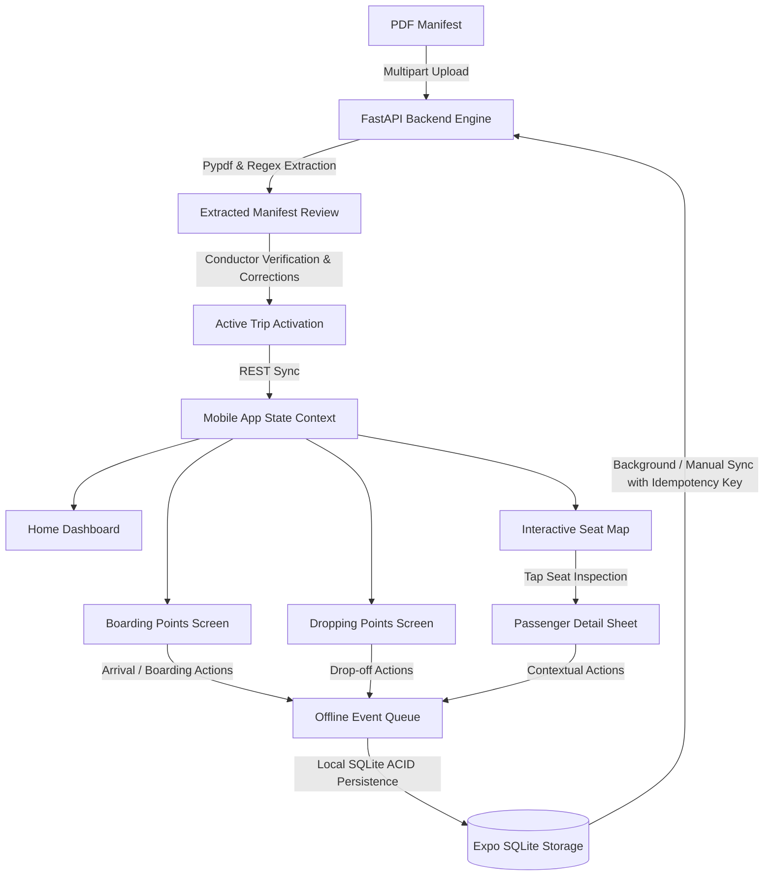
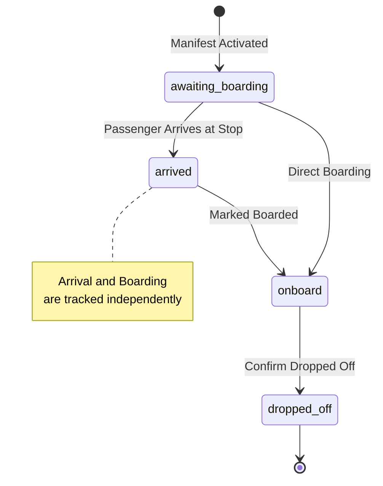

# Bus Passenger Assistant - System Architecture

## 1. Overview
The **Bus Passenger Assistant** is an offline-capable, interactive mobile application and backend designed for intercity bus conductors, drivers, and fleet supervisors. It replaces static paper or PDF passenger manifests with an active workflow system.

---

## 2. Key Components

### 2.1 Backend (`backend/`)
- **FastAPI Core**: Handles REST endpoints for trips, stops, passengers, seat maps, journey events, and batch sync.
- **Extraction Engine (`backend/app/services/pdf_extractor.py`)**:
  - Handles unstructured text and table layouts.
  - Automatically identifies route names, vehicle registration numbers, dates, and columns: Seat Number, Passenger Name, Phone Number, Pickup Stop, Drop-off Stop, and PNR Ref.
  - Flags duplicates, missing phone numbers, or unassigned seats.
- **Seating Service (`backend/app/services/seat_layout.py`)**:
  - Generates configurable 2+2 (40 capacity) and 2+1 (sleeper) top-down grid layouts.
  - Dynamically links each seat to its passenger and status.
- **Idempotent Batch Sync**:
  - `/api/sync/batch` processes batches of journey events using unique idempotency keys (`evt_<passengerId>_<type>_<timestamp>`).
  - Guarantees duplicate-action protection during retries or reconnections.

### 2.2 Mobile Client (`mobile/`)
- **React Native & Expo**: Cross-platform Android runtime.
- **AppContext (`mobile/src/state/AppContext.tsx`)**: Central state container providing optimistic UI updates, persistent caching, and offline queueing.
- **Local SQLite Store (`mobile/src/database/sqlite.ts`)**:
  - Mirrors trips, passengers, and offline event queue.
  - Ensures data is retained across app restarts or forced process terminations.
- **Native Phone Calling (`mobile/src/utils/dialer.ts`)**:
  - Uses `expo-linking` to open the native Android dialer via `tel:<number>`.
  - Cleans formatting, verifies number validity, and protects privacy.

---

## 3. Passenger Journey State Machine

---

## 4. Visual Seat Status Palette

| Status | Color Name | Hex Code | Visual Indicator |
| :--- | :--- | :--- | :--- |
| **Vacant / Unassigned** | Slate Grey | `#64748B` | User Outline Icon |
| **Awaiting Boarding** | Amber Orange | `#D97706` | Seat Number + Amber Border |
| **Arrived at Stop** | Royal Blue | `#2563EB` | Blue Highlight Badge |
| **Onboard Bus** | Emerald Green | `#059669` | Green Highlight Badge |
| **Dropped Off** | Vivid Purple | `#7C3AED` | Purple Highlight Badge |
